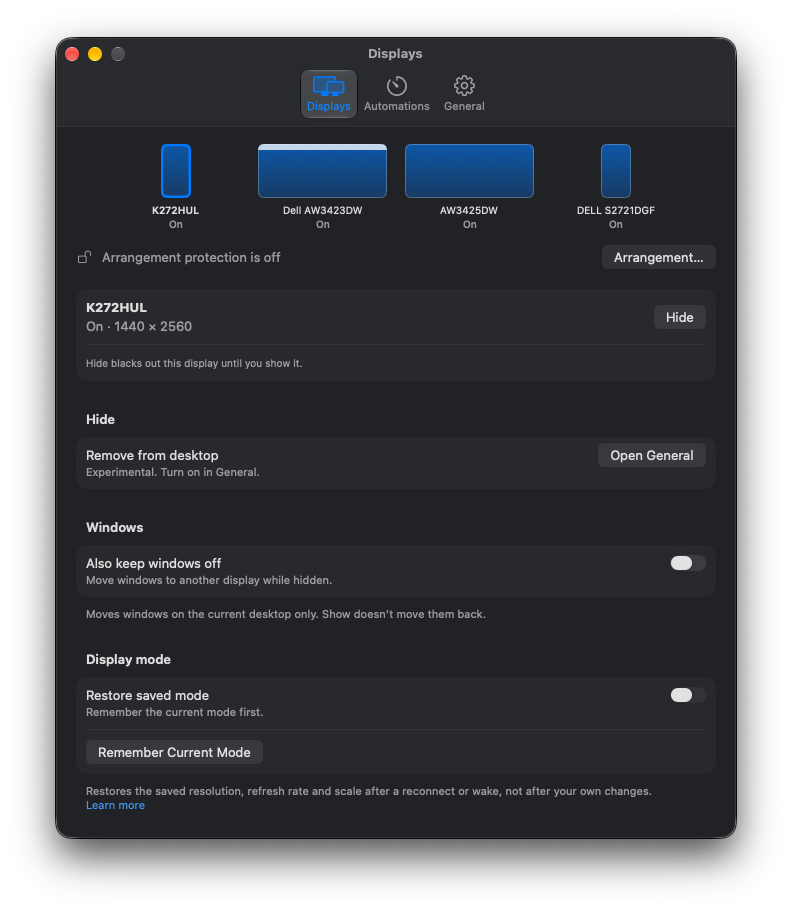

<p align="center">
  
</p>

<h1 align="center">DisplayPanel</h1>

[](https://github.com/brettinternet/displaypanel/actions/workflows/ci.yml)

A macOS CLI and menu-bar app for per-display Hide/Show, idle blackout,
click-through dimming, display sleep and experimental monitor controls.



## Install

```sh
# CLI with mise
mise use -g 'github:brettinternet/displaypanel[matching=dp-cli]'
```

Or download the app or CLI and its SHA-256 checksum from
[GitHub Releases](https://github.com/brettinternet/displaypanel/releases). Move
`DisplayPanel.app` to `/Applications`, or put `dp` on your `PATH`.

Releases use a stable self-signed certificate, not Developer ID signing or
notarization (older releases were ad-hoc signed). If macOS blocks one, verify
the checksum, then choose **Open Anyway** in System Settings → Privacy & Security.
The first upgrade from ad-hoc signing, or a signing-certificate rotation,
requires re-granting any privacy permissions once.

To build the CLI (macOS 13+, Swift 5.9+):

```sh
swift build -c release --product dp
install -m 0755 .build/release/dp ~/.local/bin/dp
```

## Use

```sh
dp list                                            # find display UUIDs
dp blackout --display UUID --idle-after 5m --watch # black out when idle
dp blackout --display UUID --mode working --overlay-opacity 60 --timeout 1h
dp sleep-displays --keep-system-awake
dp wake-displays
dp app toggle-hide --display UUID --json           # drive the running app
```

Run `dp help` or `dp <command> --help` for every option.

In the app, **Settings → Displays** hides and shows each display,
**Automations** runs idle blackout and dimming rules, and **General** holds
launch at login, the menu icon and **Experimental features**.

## Documentation

- [Usage](docs/usage.md): CLI, app, scripting and limits
- [Hide and Show](docs/display-hide-ux.md)
- [DDC input](docs/ddc-input.md) and [DDC power](docs/ddc-power.md)
- [Mirroring](docs/display-mirroring.md) and [away/back handoff](docs/display-handoff.md)
- [Display recovery](docs/display-recovery.md)
- [Private display disable](docs/display-disable.md)
- [Background research](docs/feasibility.md)
- [Development](docs/development.md)
